# Chapter 3: Discussion of Findings

This chapter presents workplace topics identified through interviews, the implemented WorkPulse modules, the researchers’ SUS usability result, and verified software test outcomes. Interview findings, participant usability ratings, and functional tests are treated as separate forms of evidence.

## Interview Findings and System Requirements

The interviews identified difficulty preparing payroll because amounts were manually entered in Excel for each employee. The owner also reported observations indicating a risk of unauthorized or proxy attendance, including the possibility of a time-in record without the employee being physically present. Other topics were monitoring work hours, transparency of employee records, and occasional inaccuracies in the attendance method used. These findings and reported observations guided the system requirements. No separate workplace-challenges questionnaire was administered, so they are presented qualitatively rather than as respondent frequencies or percentages. The reported attendance risk does not establish a verified incident of fraud.

Table 2. Interview topics and corresponding system responses

| Interview topic | WorkPulse response |

| --- | --- |

| Difficulty preparing payroll through manual Excel entry per employee | Attendance-linked payroll preparation using recorded work hours, configured rates, repayment deductions, carried earnings, and payslip summaries |

| Owner-observed risk of unauthorized or proxy attendance | Configured fingerprint identification at time-in/time-out and administrator-controlled manual alternatives with traceable records |

| Monitoring employee work hours | Daily/date-range attendance views and recorded work sessions |

| Transparency of attendance and payroll records | Personal employee portal for authorized attendance and payroll summaries, request status, and relevant notifications |

| Occasional inaccuracies in the attendance method used | Recorded sessions, source indicators, validation, and authorized corrections with reasons and history |

## Implemented Features of WorkPulse

The following descriptions refer to the implemented application. Supplied interface illustrations are retained where useful, with corrected captions. They depict the version shown in the uploaded manuscript and are not evidence that every current change has already been deployed. The narrative describes the combined Manager / Supervisor classification and the current offline and payroll behavior.

## Employee Information Management

Administrators maintain employee profiles and account access. Classifications are Regular, Extra, and Manager / Supervisor. Older supervisor records remain compatible with the combined classification; newly edited or created records use the unified management classification.

Figure 3. Employee directory interface supplied in the manuscript

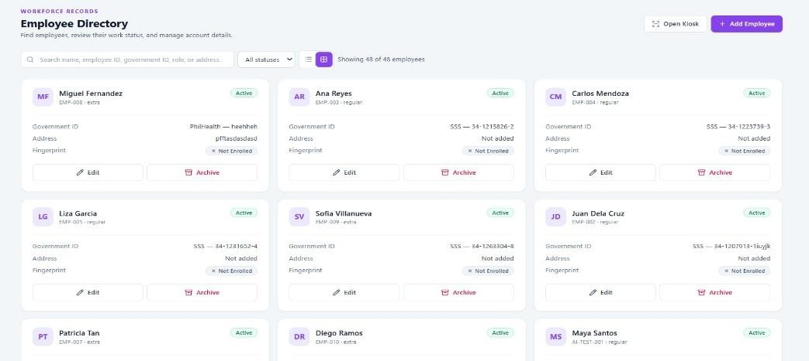

## Fingerprint-Based Attendance

The kiosk records time-in and time-out through the configured local reader and matching environment. Its current matching helper requires the local Windows backend. Physical recognition accuracy is not inferred from the application screenshots or software tests.

Figure 4. Fingerprint kiosk interface supplied in the manuscript

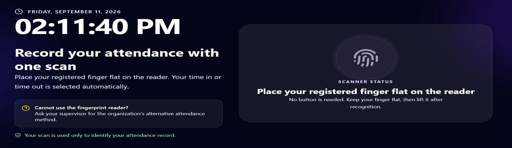

## Attendance Monitoring and Corrections

Administrators review daily and date-range attendance and up to three sessions per employee. Eligible manual entries and corrections retain their source, reason, administrator, timestamp, and history. The affected employee receives a notification. Future times, overlapping sessions, stale records, and prohibited changes to settled payroll are rejected.

Figure 5. Attendance interface supplied in the manuscript

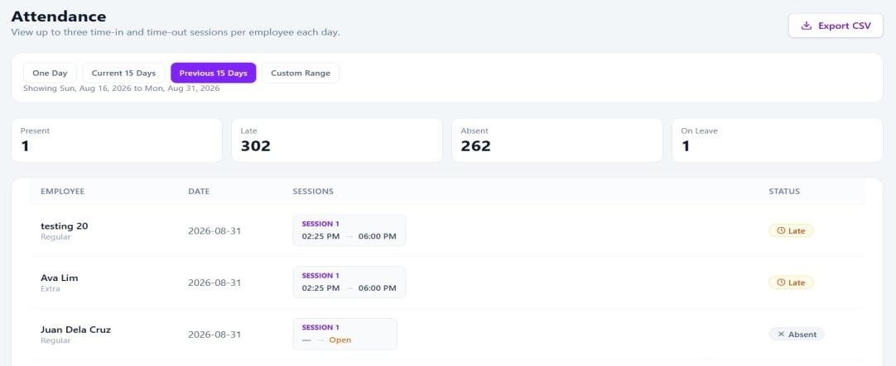

## Employee Self-Service Portal

Employees view authorized attendance, leave, cash advance, and payroll records and receive relevant notifications. Source indicators distinguish manual and edited attendance. Selected cached views and supported queued requests remain available on a prepared browser during an outage.

Figure 6. Employee overview interface supplied in the manuscript

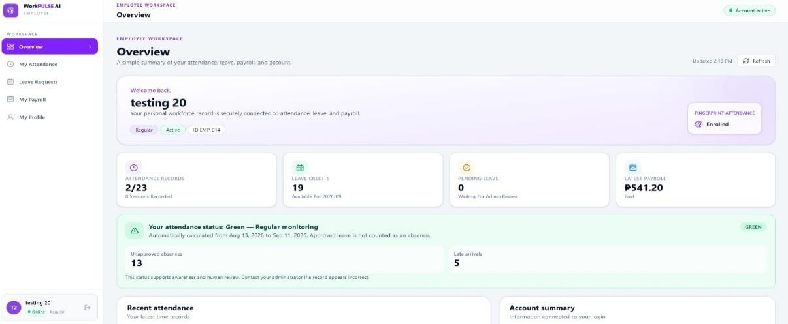

## Leave Management

Employees submit requests, and administrators review and process them. Pending requests with dates that have passed are distinguished from unresolved current or future dates. Offline saving does not approve a request; server acceptance and administrative decisions remain separate.

Figure 7. Leave-request interface supplied in the manuscript

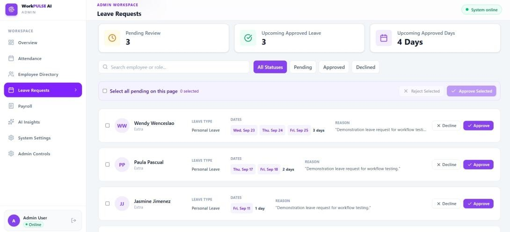

## Payroll Management

Payroll displays prepared earnings, unpaid amounts carried forward, deductions, and settlement status. Ready to Pay identifies a prepared amount, Carried to Next Period identifies unpaid earnings transferred forward, and Paid identifies confirmed settlement. These statuses reflect different stages of the same workflow.

Figure 8. Payroll interface supplied in the manuscript

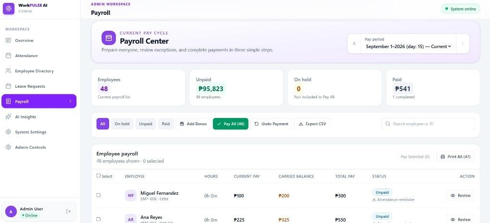

## Payroll Summary and Cash Advance Repayment

Payslip summaries distinguish current earnings, carried unpaid earnings, repayment deductions, and total payout. Request approval alone creates no outstanding advance. Confirmed cash-given records create debt, and posted repayments reduce it. Eligible installments from included earnings periods accumulate when unpaid periods are settled together.

Figure 9. Payslip interface supplied in the manuscript

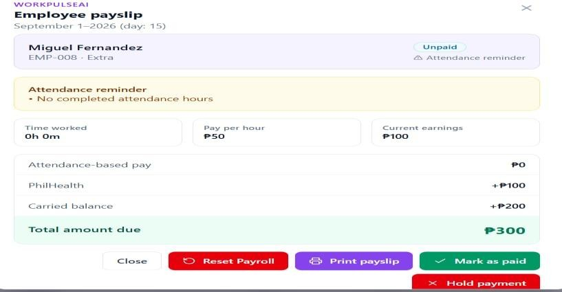

## Workforce Reporting and Analytical Insights

Dashboards summarize workforce information. Statistical attendance forecasting, risk indicators, and arrival anomaly analysis support review. No measured forecasting-accuracy result is established by the functional checks reported here.

Figure 10. Workforce overview supplied in the manuscript

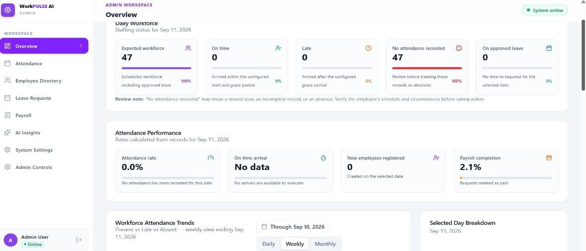

## Authentication and Record Ownership

Password and configured email verification support access. Server-side authorization separates administrator operations from employee self-service and restricts employee records by authenticated ownership. Regular, Extra, and Manager / Supervisor classifications do not confer administrator privileges.

Figure 11. Email verification interface supplied in the manuscript

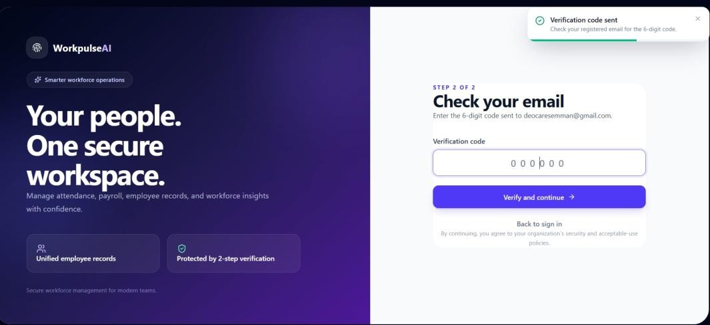

## Cloud Storage and Audit Accountability

MongoDB Atlas stores authorized cloud records. Audit events and attendance history support review of relevant actions. Browser-local storage is limited to selected cached information and queued submissions rather than a full database replica.

Figure 12. Database interface supplied in the manuscript

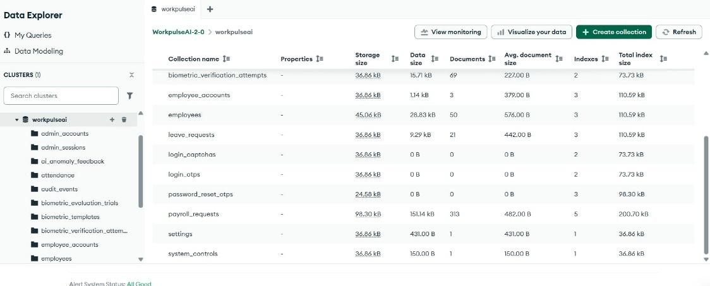

## Personal Employee Information

The portal shows personal profile and attendance-related information. Protected changes remain subject to authorization, and administrators can notify the employee about relevant changes.

Figure 13. Employee profile interface supplied in the manuscript

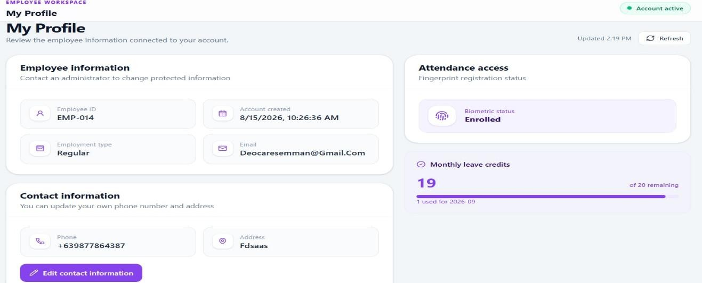

## Cash Advance Management

Employees request advances and accept the applicable repayment terms. Administrators review requests and separately confirm cash given. The system tracks outstanding debt and recorded repayments. The tests distinguish debt from an unfulfilled request and prevent carried source statements from counting the same repayment twice.

## Company and System Settings

System Settings provide hourly-rate controls for Regular, Extra, and Manager / Supervisor. The combined management classification uses one company rate. Legacy supervisor records use the configured management rate, while completed attendance sessions retain their recorded rates. This preserves historical earnings when company defaults change.

## Offline Saving and Synchronization

Supported requests are stored locally as Pending without being presented as approved or settled. Reconnection triggers session checks and employee request synchronization. Attendance waits for administrator password confirmation. The server rechecks current business rules and stable operation identifiers before marking an accepted action Synced. Failed validation produces Needs Review, and network or storage failures produce error feedback rather than false success.

## Functional Verification Results

The ten technical checklist cases in the revised source Chapter 3 were evaluated using controlled local tests. The October 12, 2026 backend run completed with 204 passing checks, zero failures, and zero skipped checks; the production build and isolated Edge browser checks also passed. Backend checks use simulated records. Browser checks use actual IndexedDB and service worker functionality with simulated API responses. The Passed status refers to these controlled testing environments, not verification of the live deployed website. The rows group tested behaviors and are not participant trials.

Table 3. Original technical checklist cases and local verification results

| No. | Test scenario | Actual result | Status |

| --- | --- | --- | --- |

| 1 | Future attendance time | Future times rejected by attendance validation; browser rejected a future capture without saving it | Passed |

| 2 | Overlapping sessions | Overlapping sessions rejected and existing attendance preserved | Passed |

| 3 | Settled payroll attendance edit | Changes to attendance covered by settled payroll rejected; original records retained | Passed |

| 4 | Unauthorized record access | An employee requesting E2 data received only their own E1 attendance, payroll, and requests; administrator API access denied | Passed |

| 5 | Offline queue and reconnection | Request persisted as Pending in IndexedDB, survived offline reload, and synchronized after reconnect; server validation tested separately | Passed |

| 6 | Duplicate synchronization | Retry reused the original operation ID; no duplicate business mutation, notification, or payroll recalculation in tested cases | Passed |

| 7 | Network interruption | Simulated lost response retained the operation locally as queued; local-save feedback shown and retry did not duplicate the action | Passed |

| 8 | Local storage failure | Injected IndexedDB write failure surfaced an error and rejected the local save | Passed |

| 9 | Payroll carried balance | Prior unpaid amounts included in carried earnings and destination payout; concurrent creation and source-linking rules passed | Passed |

| 10 | Cash advance repayment | Preparation/approval did not reduce debt; confirmed settlement applied eligible deductions; carried sources did not duplicate repayment | Passed |

In the controlled cash advance case, three eligible earnings periods produced a ₱600 repayment on settlement, reducing a ₱1,000 debt to ₱400. A second payroll case combined two ₱800 earnings periods with two ₱200 installments, producing ₱1,600 earnings, ₱400 repayment, and a ₱1,200 payout. These values are test inputs and outcomes, not actual employee transactions.

## Security and Authentication Regression Verification

Following security changes, local verification on October 12, 2026 completed with 204 passing backend checks, zero failures, and zero skipped checks. The frontend production build and isolated Edge browser checks also passed. Authentication checks exercised the actual Express routes over local HTTP with simulated database records and intercepted email-provider responses. They verify the tested software behavior, not actual email delivery, live Atlas permissions, or live Vercel/Render behavior. The following table groups the necessary security regression scenarios; its rows are not participant trials.

Table 4. Security regression scenarios and observed outcomes

| No. | Test scenario | Actual result | Status |

| --- | --- | --- | --- |

| 1 | Valid password and CAPTCHA followed by login OTP | Login generated a hashed OTP and mocked email request; a valid OTP created a session with HttpOnly and Secure cookie flags | Passed |

| 2 | Incorrect password/CAPTCHA or wrong/expired login OTP | Invalid credentials and codes were rejected without creating a session | Passed |

| 3 | Simultaneous or repeated valid OTP submission | Only one concurrent request created a session; the other request and later replay were rejected | Passed |

| 4 | Password recovery and first-login password change | Recovery code/token replay rejected; password changed and old employee sessions revoked; first-login change enabled authorized employee API access | Passed |

| 5 | MongoDB operator objects or oversized identifiers in authentication; operator employee ID in payroll | Malformed authentication identifiers rejected before query access; payroll rejected an operator object as the employee ID | Passed |

| 6 | Anonymous API access, employee access to another employee or administrator functions, and cookie writes without CSRF | Unauthorized calls rejected; attendance, payroll, requests, and notifications restricted to the signed-in employee; missing CSRF rejected and logout invalidated the session | Passed |

| 7 | Repeated fingerprint requests and email rotation to evade a rate budget | The 31st fingerprint request returned HTTP 429; changing email did not reset the tested IP budget; retry after window expiry succeeded | Passed |

| 8 | Encrypted fingerprint template round-trip and altered ciphertext | Original test templates decrypted correctly; tampered ciphertext was rejected without physical scanner testing | Passed |

| 9 | Excel export after dependency updates | Generated workbook reopened successfully and retained the test payroll value | Passed |

Dependency advisory checks reported zero known production-dependency vulnerabilities in both packages after the updates. This result is not a guarantee of security. Rate limits are process-local, and production proxy behavior requires verification. Atlas network restrictions, database-user permissions, live secrets, real backup restoration, and real OTP delivery remain deployment checks. Existing tester-account behavior was retained. Browser owner-identifier checks do not establish independent login sessions across tabs.

## Usability Evaluation Using SUS

SUS was the only questionnaire administered for respondent evaluation. The computed overall score was 80.83 out of 100. This result describes perceived usability and is separate from functional correctness, fingerprint identification accuracy, or measured processing speed.

Table 5. SUS usability result

| Measure | Result |

| --- | --- |

| Overall SUS score | 80.83 out of 100 |

| Adjective rating | Good |

| Acceptability | Acceptable |

The result indicates favorable usability feedback under the study’s interpretation. SUS is not a percentage of satisfied participants and does not provide separate security, performance-efficiency, or reliability ratings. Those additional quality questionnaires were not administered; therefore, no separate category means are reported.

## Participant Profile

Table 6. Study population distribution

| Classification | Number | Percentage |

| --- | --- | --- |

| Owner | 2 | 6.67% |

| Manager / Supervisor | 2 | 6.67% |

| Regular employee | 10 | 33.33% |

| Extra employee | 16 | 53.33% |

| Total | 30 | 100.00% |

The distribution describes the study population supplied in the revised manuscript. Extra employees constitute the largest category. It does not represent response frequencies for interview topics, nor does it establish that every participant was interviewed.

## Biometric and Deployment Evaluation Limitations

The available evaluation records do not establish physical fingerprint trial counts, failed captures, false identifications, or mean verification times. Consequently, numerical biometric accuracy and speed are not reported. The application tests verify rules surrounding attendance but do not substitute for controlled scanner trials.

The local browser checks used simulated API responses, so they do not establish live Vercel/Render outage behavior or production database recovery. The 204 passing backend checks support the specific tested conditions rather than an assertion that all possible errors have been eliminated. Analytical accuracy and long-term operational availability require additional evaluation.
